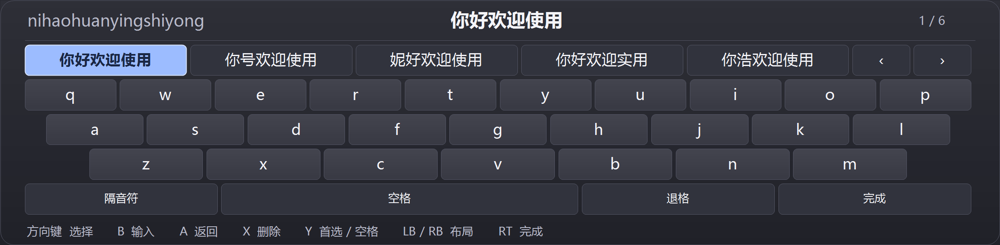

# Windows Gamepad Desktop

[简体中文](README.md) · **English**

Use an XInput gamepad as a mouse and keyboard on Windows 11 x64. The default layout uses **B to confirm** and **A to go back**. The app runs offline with standard user permissions. The app interface is in Simplified Chinese.



[Download the Windows x64 portable package](https://github.com/lightbringmonster/WindowsGamepadDesktop/releases/latest) · [v1.0.0 release notes](https://github.com/lightbringmonster/WindowsGamepadDesktop/releases/tag/v1.0.0) · [0.9.x archive](https://github.com/lightbringmonster/WindowsGamepadDesktop/releases/tag/archive-0.9)

## Build from source

Build on Windows 11 x64 with the built-in .NET Framework 4.8 family C# compiler. The build requires no .NET SDK, NuGet packages, or Node.js.

```powershell
git clone https://github.com/lightbringmonster/WindowsGamepadDesktop.git
cd WindowsGamepadDesktop
.\build.ps1 -Test
.\bin\WindowsGamepadDesktop.exe --settings
```

The build writes to `bin`. To move the app, keep the executable and its sibling `data` directory together.

## Getting started

Run `WindowsGamepadDesktop.exe` to start in the notification area. Double-click its icon or choose **设置** (Settings) from the icon's menu to open settings. The `--settings` argument also opens settings.

1. Connect an XInput-compatible controller. For a Beitong controller, select PC/XInput mode and connect via the receiver or USB. **设备** (Devices) shows the slot and live input values. Windows may identify the device as an Xbox 360-compatible controller.
2. Release all controls, then use the left stick to move the pointer. Press B to click. A direct gamepad click on a supported edit field can open the keyboard automatically. RB opens it manually.
3. Hold LB + RB, then release between two and three seconds to switch between desktop and native gamepad mode. At two seconds, a prompt tells you to release. The confirmation appears after the switch. Hold for three seconds to lock or unlock the current mode. This works in windowed and full-screen applications.
4. In **应用规则** (App Rules), add a game's executable name to enable native mode when it becomes active. The default list includes `Playnite.FullscreenApp.exe`. When unlocked, leaving a matched app restores desktop mode and returning to it enables native mode again.
5. To start with Windows, put the entire portable folder in its permanent location, run the app from there, and enable **登录时自启动** in the notification area menu. At the next sign-in, the app starts in the notification area. Run it from the new location and re-enable this option after moving the folder. This option is initially off.

**Ctrl + Alt + F12** pauses input mapping. Clear **暂停映射** in the notification area menu to resume. Double-click the notification area icon to open settings.

Desktop mode is the default at launch. Under **Settings → 设备 (Devices) → 启动模式 (Startup Mode)**, you can choose native gamepad mode or restore the mode from the last normal exit. The selection applies on the next launch.

## Desktop controls

| Input | Default action |
| --- | --- |
| Left stick / Right stick | Move the pointer / Scroll horizontally and vertically |
| B / X | Left click or hold to drag / Right click |
| LT | Tap to toggle standard and fine. Hold for at least 150 ms for temporary ultra-fine motion |
| RT | Hold to open the quick actions wheel |
| A / Y | Escape / Enter |
| D-pad | Arrow keys, with repeat |
| LB / RB | Alt + Tab / Toggle the on-screen keyboard |
| Start / Back | Windows Start menu / Win + D |
| LB + RB | Release between two and three seconds to switch modes. Hold for three seconds to toggle the lock. |

A three-second hold preserves the current mode. The lock blocks the switch gesture, mapped mode buttons, the tray command, and app rules. Unlocking keeps the current mode until the next switch or rule change. The lock lasts until the app exits.

When used individually, LB and RB act on release. Pressing them together suppresses both individual actions. After a mode change, pause, or disconnection, return the controls to neutral.

Move either stick to highlight a command. Release RT to run it or center the stick to cancel. The wheel contains Start, Task View, Show Desktop, sound output, sound input, undo, paste, and copy. In either sound list, use Up and Down or the left stick to choose a device. B confirms and A goes back by default. The selection changes the Windows system default and preserves the separate default communications device. Previously saved RT bindings stay active. To enable the wheel on an existing profile, select `RadialMenu` in its desktop bindings.

## On-screen keyboard

Use the D-pad or left stick to highlight a key. B selects, A closes, X deletes, Y inserts a space, LB/RB changes layouts, and RT finishes. **RT sends Enter** after finishing any pending composition. Use A if you only want to close the keyboard.

- **English** supports upper- and lowercase direct text input.
- **Pinyin** combines a reading of up to 64 letters and separators into words or sentences. Type `woxiangwanyouxi` and press Y to enter **我想玩游戏** in one action. Use B to select a candidate. The ‹ / › buttons page through candidates. An arrow next to a candidate means it commits only the beginning and leaves the rest of the Pinyin intact. Use `v` for ü or select the syllable separator for a reading such as `xi'an` (西安).
- **Numbers and symbols** includes common English and Chinese punctuation.
- **System IME** sends virtual keys to the active Windows input method. Candidate selection and paging depend on that IME.
- **Editing** includes navigation, selection, clipboard shortcuts, undo, redo, Tab, and Enter.

The keyboard opens on the target display by default and moves out of the way of the edit field when there is room. Auto-open checks that the gamepad click landed inside the focused editable field. Gamepad bindings for Tab, Shift + Tab, Ctrl + L, and Ctrl + F can also open it. The browser giving its address bar focus when opening or switching tabs leaves the keyboard closed. Use RB for unsupported controls. Password fields open the English layout. The app does not read field values, store typed text, or read the clipboard.

## Controllers and settings

In **按键映射** (Key Mapping), select a device and click **识别按键** (Identify Input). Release the other controls and center the sticks, then press one button or move one stick to highlight its mapping row. The app pauses mouse and keyboard output during identification. Choose the action and click **保存设置** (Save settings).

XInput exposes up to four slots. Automatic primary selection stays on the first selected slot for the current session. If it disconnects, the desktop mapper waits for that slot to return. Select another slot in settings to change the primary controller.

Slot numbers are temporary. Save a named mapping profile to reassign it when your controller changes slots. XInput devices expose a common set of controls, and other provider capabilities can add controls. See [hardware extensions](HARDWARE_EXTENSION.en.md).

Desktop bindings accept actions such as `Key:Ctrl+Shift+S`, `Key:F5`, `Keyboard`, `Mode`, and `MouseLeft`. Stick actions include `Cursor`, `Scroll`, and `None`. Edit the mode chord by entering two control IDs, such as `Back+Start`. Keep drag and precision bindings on controls outside the mode chord.

Settings are stored in `%LOCALAPPDATA%\WindowsGamepadDesktop\settings.json`. Imports appear as a draft until saved. Exports include named profiles. The repository includes [the default profile](default-profile.json).

## Compatibility

Native gamepad mode stops this app's simulated keyboard and mouse events. Games can still read the controller and manage vibration. Windows also allows Steam Input and manufacturer tools to read the same controller. If one press triggers two clicks, pause this app and check whether the other mapping is still active.

Normal Windows permissions apply. Elevated windows, the UAC secure desktop, and the lock screen can block simulated input. The app requires no driver and does not modify controller firmware.

## Documentation

| Topic | English | 简体中文 |
| --- | --- | --- |
| Architecture | [Architecture](ARCHITECTURE.en.md) | [架构](ARCHITECTURE.md) |
| Building and development | [Development](DEVELOPMENT.en.md) | [开发与构建](DEVELOPMENT.md) |
| Testing and hardware verification | [Testing](TESTING.en.md) | [测试记录](TESTING.md) |
| Hardware providers | [Hardware extensions](HARDWARE_EXTENSION.en.md) | [硬件扩展](HARDWARE_EXTENSION.md) |
| Dependencies and notices | [Third-party notices](THIRD_PARTY.en.md) | [第三方说明](THIRD_PARTY.md) |

## Contributors

- [**Codex**](https://github.com/codex) · Implementation and testing

## License

The original application code, interface assets, and documentation are licensed under the [MIT License](LICENSE). The bundled Rime Luna Pinyin dictionary retains its upstream license and attribution. See the [third-party notices](THIRD_PARTY.en.md).

Microsoft documents the input security boundary and controller slot model. [SendInput](https://learn.microsoft.com/en-us/windows/win32/api/winuser/nf-winuser-sendinput) · [XInput](https://learn.microsoft.com/en-us/windows/win32/xinput/getting-started-with-xinput)
