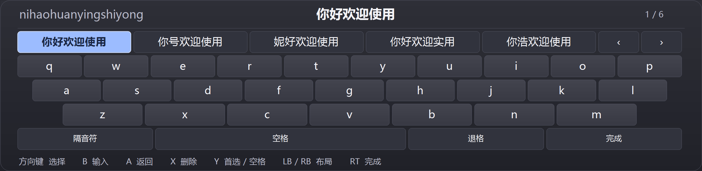

# Windows Gamepad Desktop

**简体中文** · [English](README.en.md)

Control the Windows 11 desktop and type with an XInput gamepad. [Read the English guide](README.en.md).

Windows 11 x64 手柄桌面控制器。使用 Xbox 字母标记，桌面与屏幕键盘采用 **B 确认、A 返回**。程序默认使用普通用户权限，运行时完全离线。



[下载 Windows x64 便携版](https://github.com/lightbringmonster/WindowsGamepadDesktop/releases/latest) · [v1.0.0 发布说明](https://github.com/lightbringmonster/WindowsGamepadDesktop/releases/tag/v1.0.0) · [0.9.x 历史归档](https://github.com/lightbringmonster/WindowsGamepadDesktop/releases/tag/archive-0.9)

## 从源码构建

需要 Windows 11 x64，使用系统自带的 .NET Framework 4.8 系列编译器。构建无需安装 .NET SDK、NuGet 或 Node.js。

```powershell
git clone https://github.com/lightbringmonster/WindowsGamepadDesktop.git
cd WindowsGamepadDesktop
.\build.ps1 -Test
.\bin\WindowsGamepadDesktop.exe --settings
```

构建产物在 `bin`。如需移动到其他位置，复制整个 `bin`，让 EXE 与 `data` 文件夹保持同级。

## 开始使用

1. 解压整个便携包，将 EXE 和同级 `data` 文件夹放在一起，双击 `WindowsGamepadDesktop.exe`。首次启动显示设置，其余时间常驻通知区域。
2. 让北通手柄通过接收器或 USB 以 PC / XInput 模式连接。在「设备」中查看槽位、实时摇杆、扳机和按键。Windows 可能显示 Xbox 360 兼容名称。无线方式是否可用取决于手柄当前输出的协议。
3. 放开摇杆和所有按键，再用左摇杆移动指针。用 B 直接点击可编辑输入框可自动弹出键盘，RB 可手动呼出。**同时按住 LB + RB 约 2 秒后松开**，可在桌面键鼠与原生手柄之间切换。到 2 秒时屏幕会提示「松开切换」，松手确认后显示「已切换」。持续按到 3 秒可锁定或解锁当前模式。
4. 在「应用规则」添加游戏的实际进程文件名并保存。便携包预置 `Playnite.FullscreenApp.exe`，可在列表中删除。未锁定时，离开匹配进程会回到桌面，切回该进程会再次使用原生手柄。手动切换适用于窗口化和全屏。
5. 要随 Windows 登录启动，先将整个便携目录放到长期使用的位置，再从该位置运行程序，右键通知区域的应用图标并勾选「登录时自启动」。下次登录时程序会常驻通知区域。移动目录后，需从新路径运行并重新勾选。初始默认关闭。

**紧急暂停**使用 Ctrl + Alt + F12。恢复时从托盘取消「暂停映射」。快捷键被占用时，设备页会显示提示。再次双击正在运行的程序会打开设置。

默认启动进入桌面键鼠模式。在「设置 → 设备 → 启动模式」可改为原生手柄，或沿用上次正常退出时的模式。设置从下次启动生效。

## 桌面映射

| 输入 | 默认动作 |
|---|---|
| 左摇杆 / 右摇杆 | 移动指针 / 横向及纵向滚动 |
| B / X | 鼠标左键 / 右键。B 可按住或连续点击两次 |
| LT | 短按切换标准和精细。按住至少 150 毫秒临时进入极精，松手恢复原档 |
| RT | 按住打开常用操作轮盘 |
| A / Y | Esc / Enter |
| 十字键 | 四向方向键，按住可重复 |
| LB / RB | Alt + Tab / 打开或收起屏幕键盘 |
| Start / Back | Windows 开始菜单 / Win + D |
| LB + RB | 按满 2 秒、未满 3 秒时松开切换。持续按满 3 秒锁定或解锁 |

3 秒手势保持当前控制模式。锁定期间，2 秒手势、单键切换、托盘切换和应用规则都无法改变模式。解锁后仍维持当前模式，下次手动切换或匹配规则变化时恢复正常切换。锁定在本次程序运行期间有效。

组合键成员的单独操作在松开时执行。两个成员按下时间一旦重叠，本次手势就不会触发各自的单键动作。切换、断开或暂停后，先把摇杆及按键回中再开始下一次操作。

轮盘打开后，拨动任一摇杆高亮命令，松开 RT 执行，摇杆回中可取消。轮盘包含开始菜单、任务视图、显示桌面、声音输出、声音输入、撤销、粘贴和复制。选声音输入或输出后，用上下方向键或左摇杆选择设备，默认按 B 确认、A 返回。切换会更新 Windows 的系统默认设备，单独设置的默认通信设备继续生效。B 可按住拖拽。已保存的 RT 绑定会继续生效，可在「按键映射」中选择 `RadialMenu` 启用轮盘。

## 屏幕键盘

方向键和左摇杆选格，B 输入，A 关闭，X 删除（可长按），Y 空格，LB / RB 切换布局，RT 完成。**完成会发送 Enter**，在聊天、表单等应用里可能直接提交。只想收起时按 A。

- **English** 支持大小写和直接输入字符，目标输入法保持当前状态。
- **拼音** 支持最多 64 个字母和隔音符连续输入，自动组合词和句子。例如输入 `woxiangwanyouxi`，按 Y 一次上屏「我想玩游戏」。也可以用方向键选候选、按 B 确认，候选较多时用 ‹ / › 翻页。带箭头的候选先确认前半段，余下拼音可继续编辑。ü 用 v，遇到音节边界歧义时可选「隔音符」，例如 `xi'an` 输入「西安」。
- **数字符号** 包含数字、中英文标点和常用符号。
- **系统 IME** 把字母和数字作为虚拟键发送给目标应用。可用「切换输入法」切换 Windows 输入法，使用数字、上页和下页操作支持数字选词的系统候选窗。系统候选的显示、编号和翻页行为由当前 IME 决定。
- **编辑** 提供光标、按方向扩选、全选、撤销、剪贴操作、Tab 和换行。复制与粘贴走系统快捷键，程序不读取剪贴板内容。

键盘默认跟随目标显示器，靠近底部，输入框与键盘相交时尝试移到顶部。可在设置中锁定显示器、调整占屏比例和初始布局。自动弹出会核对手柄点击的位置和可编辑控件。由手柄映射触发的 Tab、Shift + Tab、Ctrl + L 或 Ctrl + F 也可呼出键盘。打开或切换浏览器标签页时，地址栏自动取得焦点不会呼出键盘。遇到画布、自绘控件或不提供可访问性信息的应用，聚焦目标后按 RB。密码控件自动使用 English 布局。程序不读取字段值、不保存输入内容，也不写按键日志。

## 设备和配置

在「按键映射」选择设备后，点「识别按键」。松开其他按键并让摇杆回中，再按下一个键或拨动一个摇杆，设置会定位到对应行。识别期间暂停程序的键鼠输出。选好动作后再点「保存设置」。

设置按设备能力生成映射行。桌面动作可直接填写，例如 `Key:Ctrl+Shift+S`、`Key:F5`、`Keyboard`、`Mode`、`MouseLeft`。摇杆支持 `Cursor`、`Scroll` 和 `None`。键盘动作可用下拉框选择。切换组合在「模式组合键」中填写两个输入 ID，例如 `Back+Start`。拖拽或精细移动应分配给未参与切换组合的按键。

XInput 提供四个槽位。自动主控会锁定本次会话首次选中的槽位，主控断开后等待该槽位恢复。可在设置中明确选择其他主控。槽位不代表永久硬件身份。可在「按键映射」选择槽位，输入“北通”等配置名，点击「载入 / 新建」并保存。接收器换槽后，把同一名称分配给新槽位即可。备用手柄仍可被游戏读取。

用户设置写入 `%LOCALAPPDATA%\WindowsGamepadDesktop\settings.json`。导入只载入编辑草稿，点击「保存设置」后生效。导出包含当前草稿，包括已命名的设备配置。`default-profile.json` 可用于恢复默认。登录启动状态保存在当前用户的 Windows 启动项。

## 与其他手柄软件共存

XInput 允许多个程序读取同一手柄。本程序在原生模式停止合成键鼠输入，游戏继续接收手柄并管理震动。桌面模式无法阻止其他程序同时响应原生按键。

如果一次 B 出现两次点击，先从本程序托盘暂停，再按 B。若仍产生鼠标点击，可检查 Steam 的桌面布局、北通配套软件或飞智空间站是否同时启用了桌面映射。Playnite 全屏等自带手柄导航的应用可加入原生模式列表。安装包不会改动第三方配置。

Windows 的权限隔离、UAC 安全桌面和锁屏会限制输入，普通权限程序对更高权限窗口的 SendInput 也可能失败。程序不使用驱动、不独占硬件，不修改固件和板载配置。真正的双人游戏、震动与当前机型的物理操作验收状态见 [测试记录](TESTING.md)。

## 文档

- [测试记录及手柄验收步骤](TESTING.md)
- [模块与运行流程](ARCHITECTURE.md)
- [构建、运行和阶段记录](DEVELOPMENT.md)
- [新增设备及体感扩展](HARDWARE_EXTENSION.md)
- [第三方依赖与许可证](THIRD_PARTY.md)

## 贡献者

- [**Codex**](https://github.com/codex) · 实现与测试

## 开源许可

项目自主编写的源码、界面和文档使用 [MIT 许可证](LICENSE)。随附的 Rime 朙月拼音词库保留原上游许可和署名。具体文件及对应许可见 [第三方说明](THIRD_PARTY.md)。

系统输入的权限边界及槽位模型可查阅微软文档。[SendInput](https://learn.microsoft.com/en-us/windows/win32/api/winuser/nf-winuser-sendinput) · [XInput](https://learn.microsoft.com/en-us/windows/win32/xinput/getting-started-with-xinput)
